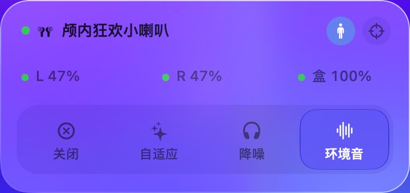

# Galaxy Buds Widget for macOS

A native macOS Liquid Glass desktop widget and web workbench for Samsung Galaxy Buds, built on top of [GalaxyBudsClient](https://github.com/timschneeb/GalaxyBudsClient).



## Features

- **Native Liquid Glass Desktop Widget (`AppKit` / `NSVisualEffectView`)**: Floating translucent card displaying Left, Right, and Case battery levels alongside quick ANC / Ambient / Adaptive / Off switching and posture monitor controls.
- **3D Product Render Preview**: Displays left/right earbud renders matching your selected Galaxy Buds model and color variant.
- **Equalizer (Samsung Presets + 9-Band Custom)**: Switch between Off, Bass Boost, Soft, Dynamic, Clear, Treble Boost, or drag the interactive 9-band bar & spline chart (`63 Hz` – `16 kHz`, `-10 dB` to `+10 dB`) to customize your sound in real time.
- **Seamless Connection & Multipoint**: Toggle Seamless Earbud Connection and auto-restore multipoint state upon connect.
- **Neck Posture Monitor**: Uses earbud IMU telemetry to detect slouching and blurs the screen as a gentle reminder, with one-click calibration, trigger angle, and blur intensity controls.
- **Multi-Language Support**: English by default, with live switching between **English** and **Simplified Chinese (`中文`)** across the desktop widget, menu bar tray, and web workbench.

## Requirements

- macOS (Apple Silicon `arm64`, tested on macOS Sequoia / 26+)
- [.NET 10 SDK](https://dotnet.microsoft.com/) (for building from source)
- Xcode Command Line Tools (`clang++`)

## Build & Run from Source

1. Build the native macOS Liquid Glass widget dylib:

```bash
./GalaxyBudsClient.Platform.OSX/Native/build-buds-widget.sh
```

2. Publish the macOS `osx-arm64` app bundle:

```bash
dotnet publish GalaxyBudsClient/GalaxyBudsClient.csproj -c Release -r osx-arm64 \
  -p:UseMacOSSDK=true \
  -p:AllowMissingPrunePackageData=true \
  -p:ValidateXcodeVersion=false
```

3. Install the generated `.pkg` or run the published `.app`, and sign `Contents/MonoBundle/*.dylib` and the `.app` bundle ad-hoc if running locally.

## License

Licensed under **GPLv3**, following the upstream [GalaxyBudsClient](https://github.com/timschneeb/GalaxyBudsClient) project.
