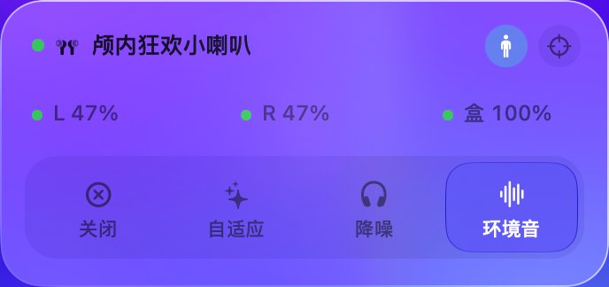

# Galaxy Buds Widget for macOS

> [English](README.md) | **简体中文**

[-blue.svg)](https://github.com/ARRIIIIIS/galaxy-buds-widget-macos/releases)
[](https://github.com/ARRIIIIIS/galaxy-buds-widget-macos/releases/latest)
[](https://www.gnu.org/licenses/gpl-3.0)

**Galaxy Buds Widget for macOS** 是一款开源的原生 macOS **液态玻璃（Liquid Glass）桌面组件**、**9 段均衡器**与**低头坐姿护颈监测**工具，基于 [GalaxyBudsClient](https://github.com/timschneeb/GalaxyBudsClient) 构建。

由于三星并未提供 macOS 官方客户端，本项目为 Apple Silicon（`arm64`）Mac 带来开箱即用的桌面级耳机控制体验：实时显示左耳/右耳/充电盒电量、4 档降噪切换、三星预设 + 9 段自定义 EQ、双设备无缝切换与耳机 IMU 坐姿检测。



---

## 支持型号

支持三星 Galaxy Buds 全系主流型号及配色（设置向导内置左右耳 3D 实物渲染图预览）：

- **Galaxy Buds4 Pro** / **Galaxy Buds4**
- **Galaxy Buds3 Pro** / **Galaxy Buds3** / **Galaxy Buds3 FE**
- **Galaxy Buds2 Pro** / **Galaxy Buds2**
- **Galaxy Buds Pro**
- **Galaxy Buds Live**
- **Galaxy Buds+** / **Galaxy Buds**

---

## 核心特性

- **原生液态玻璃桌面组件（`AppKit` / `NSVisualEffectView`）**：`344×162` 半透明悬浮卡片常驻桌面，具备 `1px` 棱边高光、点击焦散光晕反馈以及顶部 `0.25s` 长按防误触拖动。
- **4 档降噪平滑切换**：桌面一键切换 **关闭 / 自适应 / 降噪 / 环境音**，带胶囊滑动动画。
- **均衡器（三星预设 + 9 段自定义）**：支持 **Off / Bass Boost / Soft / Dynamic / Clear / Treble Boost**，也可在交互式 9 段柱状图与曲线（`63 Hz – 16 kHz`，`-10 dB ~ +10 dB`）中实时拖拽调音。
- **无缝连接与双设备协同**：支持开启 Seamless Connection 并在连接后自动恢复双设备无缝切换状态。
- **低头坐姿护颈监测（IMU）**：通过耳机内置 IMU 四元数传感器实时监测低头角度，超过阈值时自动触发屏幕渐变模糊提醒；支持一键校准、触发角度阈值和模糊强度调节。
- **极简菜单栏 + 网页设置向导**：菜单栏仅保留 3 个核心入口（设置向导、重启、退出），在浏览器中完成蓝牙配对、3D 渲染预览、EQ 调节与坐姿配置。
- **多语言支持（默认英文，支持中文实时切换）**：桌面组件、菜单栏托盘与网页工作台默认英文，可在向导右上角一键切换为 **简体中文**。

---

## 下载与安装（Apple Silicon Mac）

1. 前往 [**GitHub Releases**](https://github.com/ARRIIIIIS/galaxy-buds-widget-macos/releases/latest) 下载最新压缩包（`Galaxy-Buds-Widget-macOS-v1.0.0-arm64.zip`）。
2. 解压后将 **`Galaxy Buds Manager.app`** 拖入 **`/Applications`** 应用程序文件夹。
3. 由于应用采用本地 ad-hoc 签名，首次打开如遇 macOS 安全拦截提示，可在终端执行：
   ```bash
   xattr -cr "/Applications/Galaxy Buds Manager.app"
   ```
   之后即可从 `/Applications` 或聚焦搜索正常启动。

---

## 从源码构建

### 环境要求
- macOS（Apple Silicon `arm64`）
- [.NET 10 SDK](https://dotnet.microsoft.com/)
- Xcode Command Line Tools (`clang++`)

### 构建步骤
1. 编译原生液态玻璃组件动态库：
   ```bash
   ./GalaxyBudsClient.Platform.OSX/Native/build-buds-widget.sh
   ```
2. 发布 `osx-arm64` 应用包：
   ```bash
   dotnet publish GalaxyBudsClient/GalaxyBudsClient.csproj -c Release -r osx-arm64 \
     -p:UseMacOSSDK=true \
     -p:AllowMissingPrunePackageData=true \
     -p:ValidateXcodeVersion=false
   ```
3. 本地运行前对 `Contents/MonoBundle/*.dylib` 及 `.app` 进行 ad-hoc 签名即可。

---

## 开源协议

基于 **GPLv3** 协议开源，遵循上游 [GalaxyBudsClient](https://github.com/timschneeb/GalaxyBudsClient) 项目许可。
